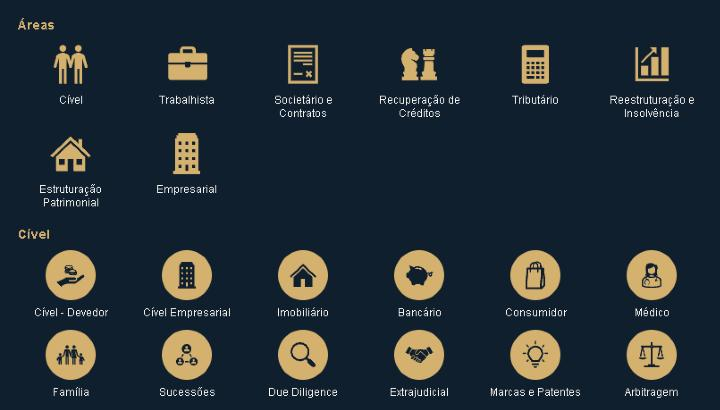

# Ícones das áreas de atuação

**Regra:** sempre que uma tela, documento, proposta, apresentação ou mensagem falar de uma área de atuação do escritório, usar o ícone desta tabela. Não inventar outro ícone para a área.

Fonte: apresentação comercial "Nova Apresentação Comercial - Cível" (novembro/2026): slide 3 (mapa das 8 áreas), slide 4 (linha das áreas) e slides 6 a 10 (áreas do Cível). Os arquivos foram tirados dela sem mudar o desenho.

## Cores e estilo

- **Áreas:** ícone dourado `#D5B170` sobre azul-marinho `#101F2E` (como na apresentação). No Design System V2 esses tons são `brand-gold` (`#D4B070`) e `brand-navy` (`#16263B`).
- **Áreas do Cível:** ícone azul-marinho `#101F2E` dentro de um círculo dourado `#D5B170`.
- Os SVGs têm a cor gravada (não usam `currentColor`). Para outra cor, troque o `fill` no arquivo ou use o equivalente Lucide da tabela.

## Áreas

Arquivos em `public/brand/areas/` (no navegador: `/brand/areas/<arquivo>`).

| Área no CRM | Nome na apresentação | Ícone | Arquivo | Desenho | Equivalente Lucide (telas do CRM) |
|---|---|---|---|---|---|
| Cível | Cível |  | `civel.svg` | Dois homens | `Users` |
| Trabalhista | Trabalhista |  | `trabalhista.svg` | Maleta | `Briefcase` |
| Societário e Contratos | Societário e Contratos |  | `societario-e-contratos.svg` | Contrato | `FileSignature` |
| Recuperação de Créditos | Recuperação Estratégica de Créditos |  | `recuperacao-de-creditos.svg` | Peças de xadrez | `ChessKnight` |
| Tributário | Tributário |  | `tributario.svg` | Calculadora | `Calculator` |
| Reestruturação e Insolvência | Reestruturação Empresarial |  | `reestruturacao-e-insolvencia.svg` | Gráfico de barras subindo | `ChartColumnIncreasing` |
| — (não é área do CRM) | Estruturação Patrimonial |  | `estruturacao-patrimonial.svg` | Casa | `House` |
| — (não é área do CRM) | Empresarial |  | `empresarial.svg` | Edifício | `Building2` |

## Áreas do Cível

Arquivos em `public/brand/areas/civel/`.

| Área | Ícone | Arquivo | Desenho | Equivalente Lucide |
|---|---|---|---|---|
| Cível - Devedor |  | `civel-devedor.svg` | Filantropia (mão) | `HandHeart` |
| Cível Empresarial (Contencioso Estratégico) |  | `civel-empresarial.svg` | Edifício | `Building2` |
| Direito Imobiliário |  | `direito-imobiliario.svg` | Casa | `House` |
| Direito Bancário |  | `direito-bancario.svg` | Cofrinho | `PiggyBank` |
| Direito do Consumidor |  | `direito-do-consumidor.svg` | Sacola de compras | `ShoppingBag` |
| Direito Médico |  | `direito-medico.svg` | Médica | `Stethoscope` |
| Direito de Família |  | `direito-de-familia.svg` | Família com duas crianças | `Users` |
| Sucessões |  | `sucessoes.svg` | Ciclo com pessoas | `RefreshCcw` |
| Due Diligence |  | `due-diligence.svg` | Lupa | `Search` |
| Advocacia Extrajudicial |  | `advocacia-extrajudicial.svg` | Aperto de mão | `Handshake` |
| Marcas e Patentes |  | `marcas-e-patentes.svg` | Lâmpada acesa | `Lightbulb` |
| Arbitragem |  | `arbitragem.svg` | Balança da justiça | `Scale` |

## Observações

- **Divergência na apresentação:** no slide 4 a calculadora aparece em "Empresarial" (o slide não tem Tributário). Vale o slide 3, que tem as 8 áreas: calculadora = Tributário, edifício = Empresarial.
- **Licença:** os desenhos são da biblioteca de ícones do Microsoft Office. O CRM usa os SVGs por decisão do escritório (04/11/2026); se o uso fora do Office precisar ser revisto, trocar para o equivalente Lucide da tabela é uma linha por área em `area-lucide-icon.tsx`.
- **No CRM (04/11/2026):** `getAreaLucideIcon` (`src/lib/crm/area-lucide-icon.tsx`) devolve estes SVGs, desenhados por máscara na cor do texto, para as 6 áreas do CRM (e Estruturação Patrimonial / Empresarial). Vale em todo lugar que já usava o ícone da área: `AreaIconLabel`, `PracticeAreaIconBadge` (com a cor de cada área), Novo Lead (`AREA_ICONS` usa o mesmo helper), catálogo de escopos, carteira, contratos e o ICP para as áreas que ele reconhece. Exceção: "Contratos", "Distressed Deals" e "Operações Legais" do ICP ainda têm ícone próprio em `src/components/crm/icp/icp-area-icon.tsx`.
